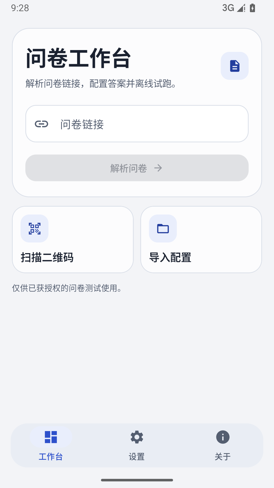
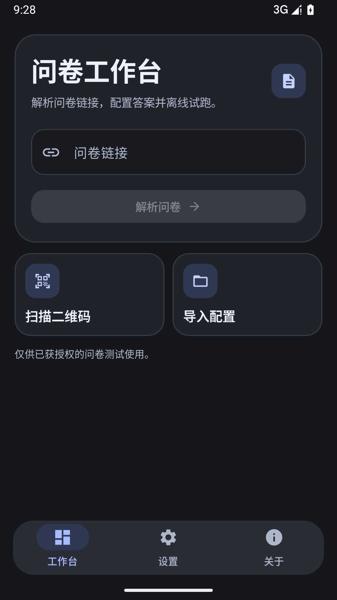

<div align="center">
  <h1>SurveyController Android</h1>
  <p></p>
  <p>在手机上扫码载入问卷、配置答案策略，并对已获授权的问卷进行自动化测试。</p>
  <p>支持问卷星、腾讯问卷和 Credamo（见数）。需要 Android 8.0 或更新版本。</p>
  <p>
    <a href="https://github.com/SurveyController/SurveyController-Android/releases/latest"></a>
    <a href="LICENSE"></a>
  </p>
  <p><a href="#下载安装">安装说明</a> · <a href="#功能特性">功能特性</a> · <a href="#交流与贡献">交流与贡献</a></p>
  <p>
    <a href="static/screenshot/workspace-light.png"></a>
    <a href="static/screenshot/workspace-dark.png"></a>
  </p>
  <p><sub>开发版预览 · Android 浅色与深色工作台</sub></p>
</div>

> [!IMPORTANT]
> 本项目面向 HTTP 接口学习和问卷测试。请先取得问卷所有者的授权，并在约定的测试范围内使用。

## 功能特性

| 能力 | 问卷星 | 腾讯问卷 | Credamo（见数） |
| --- | --- | --- | --- |
| 粘贴链接或用相机扫码 | 支持 | 支持 | 支持 |
| 自定义答案比例 | 支持 | 支持 | 支持 |
| 自定义 AI 填空 | 支持 | 支持 | 支持 |
| 设置作答时长 | 支持 | 支持 | 支持 |
| 从 Excel 反填 | 支持 | — | — |
| 设置作答日期窗口 | — | — | 支持 |

Android 端使用 Kotlin 和 Jetpack Compose，支持配置导入导出、任务暂停与恢复和运行日志。任务参数可调整并发、提交间隔、代理地区和设备类型，量表题支持信度计划。配置文件可用于在桌面端和移动端之间迁移设置，具体可用项受问卷平台和题型影响。

开发版加入了分区配置、题目搜索和离线试跑。使用同一份配置和随机种子，可以在本机复现最多 20 份样例。从逐题答案、选项分布或配置检查结果中，可以直接跳回对应题目。试跑只生成本地预览，AI 填空显示占位文本。

## 开始使用

### 使用要求

- Android 8.0（API 26）或更新版本。发布包面向 `arm64-v8a` 设备。

### 下载安装

1. 在 GitHub Releases 的附件中下载签名 APK。 [下载最新稳定版](https://github.com/SurveyController/SurveyController-Android/releases/latest)
2. 在设备上打开 APK 并按系统提示安装。

### 从源码运行

需要 JDK 17 和 Android SDK 35。也可以在 Android Studio 中打开工程并运行 `app`。

```bash
git clone https://github.com/SurveyController/SurveyController-Android.git
cd SurveyController-Android
./gradlew :app:assembleDebug
./gradlew :app:testDebugUnitTest
```

调试包位于 `app/build/outputs/apk/debug/app-debug.apk`。

## 使用方法

1. 粘贴公开问卷链接，或用相机扫描二维码。
2. 解析问卷后进入配置，调整题目权重、条件规则和运行参数。
3. 检查配置后，在测试问卷上执行任务。

可以在「设置」中配置自定义 AI。导出配置时默认省略 API 密钥。 [上游使用教程](https://surveydoc.hungrym0.com/)

## 交流与贡献

- 遇到问题时，请提供应用版本、Android 版本、复现步骤和预期结果。分享截图或日志前请隐去密钥和问卷数据。 [GitHub Issues](https://github.com/SurveyController/SurveyController-Android/issues)
- 欢迎贡献题型适配、移动端交互和测试用例。提交 PR 时请写明改动和验证方式。
- 开发者可以从上游核心库了解平台和题型的适配方式。 [surveycore-py](https://github.com/SurveyController/surveycore-py)
- QQ 交流群 **346131215**。


## 贡献者与许可

感谢 [hungryM0](https://github.com/hungryM0)、[shiaho777](https://github.com/shiaho777)、[BingBuLiang](https://github.com/BingBuLiang)、[dAwn-Rebirth](https://github.com/dAwn-Rebirth)、[Moyuin-aka](https://github.com/Moyuin-aka)、[qintaiyang](https://github.com/qintaiyang) 和上游团队的贡献。Android 端是社区维护的安卓移植版，源码按 GPL-3.0 分发。 [Windows 上游](https://github.com/SurveyController/SurveyController) · [Mac 版](https://github.com/SurveyController/SurveyController-Mac) · [许可证](LICENSE) · [Star History](https://www.star-history.com/#SurveyController/SurveyController-Android&type=date)
